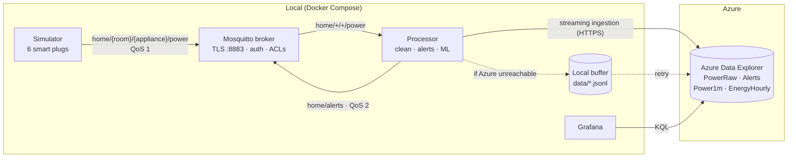

# Architecture

> Save as `docs/architecture.md`. Keep this in sync with the code; it becomes the architecture section of the final report.

## Data flow

## Layers

| # | Layer | Component | Owner | Notes |
|---|-------|-----------|-------|-------|
| 1 | Device | `simulator/` | Mashal | One thread per appliance, reading every 5 s |
| 2 | Communication | MQTT (paho-mqtt) | Mashal | QoS 1 readings, QoS 2 alerts, Last Will |
| 3 | Middleware | Eclipse Mosquitto | Mashal | Persistence, ACLs, TLS |
| 4 | Processing | `processor/` | Collins | Cleaning, thresholds, Isolation Forest |
| 5 | Storage | Azure Data Explorer | Issaq | Raw 30 days, roll-ups 365 days |
| 6 | Visualization | Grafana | Issaq | Live, weekly, heatmap, cost, alerts |
| 7 | Security | TLS, ACLs, Entra ID | Mashal | Least-privilege ADX roles |

## Security summary

| Link | Protection |
|------|------------|
| Plug → broker | TLS 1.2, username/password, ACL limits each plug to its own topics |
| Processor → broker | TLS, own user, read readings / write alerts only |
| Processor → ADX | HTTPS, Entra ID service principal, Database Ingestor role |
| Grafana → ADX | HTTPS, Entra ID service principal, Database Viewer role |
| Secrets | `.env` only, shared privately, never committed |

## Reliability features

- Mosquitto persistence to disk + persistent sessions (`clean_session=False`)
- Client reconnect with exponential backoff (1 s → 60 s)
- Last Will messages mark devices offline
- Processor buffers to disk when Azure is unreachable and retries

## Changes from the proposal

| Proposal | Now | Why |
|----------|-----|-----|
| InfluxDB 2.x + Flux | Azure Data Explorer + KQL | See `decisions.md` |
| Roll-ups in Python | ADX materialized views | Less code, always up to date |
